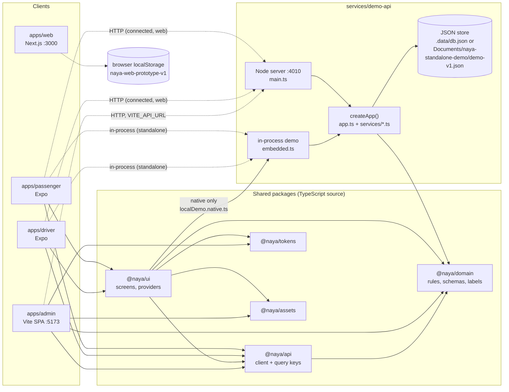
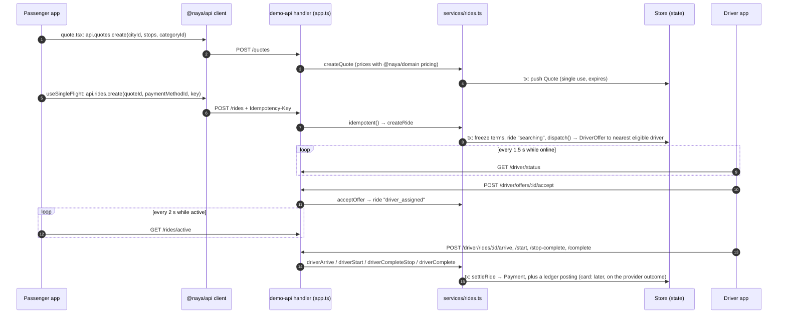

# Architecture overview

What each app, package and service is, who may import whom, where each feature lives and how a ride travels through
the code. Owner: not assigned yet (see [docs/README.md](../README.md)).
Last verified: 2026-10-13 against branch `chore/docs-foundation-and-fixes` (based on c38429d).

Related: [runtime-modes.md](runtime-modes.md) (which backend each build talks to),
[api-reference.md](api-reference.md) (every route, generated), [permissions.md](permissions.md) (admin permissions
and mobile route guards).

## The pieces

| Path | Package | What it is | Runs as |
|---|---|---|---|
| `apps/passenger` | `@naya/passenger` | Expo SDK 57 app for passengers (`ma.naya.passagere`) | iOS, Android, Expo web on :8081 |
| `apps/driver` | `@naya/driver` | Expo SDK 57 app for drivers (`ma.naya.chauffeuse`) | iOS, Android, Expo web (e2e uses :8082) |
| `apps/admin` | `@naya/admin` | Operations console: Vite + React Router 7 + Tailwind | browser SPA on :5173 |
| `apps/web` | `@naya/web` | Next.js 16 landing page plus a `/backoffice` prototype that keeps its data in `localStorage` | :3000 |
| `packages/domain` | `@naya/domain` | Pure TypeScript rules: money, pricing, state machines, entities, zod schemas, French labels and errors | everywhere (Node, Metro, browser) |
| `packages/api` | `@naya/api` | Typed HTTP client (`client.ts`), query keys (`keys.ts`), React provider (`react.ts`) | inside every client |
| `packages/ui` | `@naya/ui` | Shared React Native primitives, feature screens and app providers, consumed as TS source | inside both Expo apps |
| `packages/tokens` | `@naya/tokens` | Colours (light and dark), spacing, motion; Tailwind preset | Expo apps; preset used by the admin |
| `packages/assets` | `@naya/assets` | Brand SVGs, logo concepts, legacy PNGs | Expo apps and the admin |
| `services/demo-api` | `@naya/demo-api` | The only backend: one Hono app over a JSON file store | Node on :4010, in-process inside native demo builds, in vitest |
| `e2e` | `@naya/e2e` | Playwright specs against Expo web and the admin | test runner |
| `plugins/` | — | Expo config plugins used by both apps (iOS 27 UIScene, paths with spaces) | at `expo prebuild` |

There is no production backend. Every external service (SMS, payments, telephony masking, remote push) is
simulated or missing, and identity review is a person in the admin (auto-approved in standalone builds); see
[status/integrations.md](../status/integrations.md).

## System diagram

Solid arrows are `import`s between workspace packages. Dotted arrows are requests at run time.



`apps/web` imports no `@naya/*` package and calls no API. It is a separate prototype with its own data model
(decision pending: [ADR-0038](../adr/0038-canonical-backoffice.md), backlog P20).

## Dependency rules

What each package imports today, checked with a scan of every `import`, `export … from` and `require` in its sources
on 2026-10-13. "Declared" means listed in its `package.json`. No lint rule enforces the "must not" column yet;
review and the scan below are the only checks.

| Package | Imports these workspace packages | Must not import |
|---|---|---|
| `@naya/domain` | none (only `zod`) | React, React Native, Node built-ins, any `@naya/*` |
| `@naya/api` | `@naya/domain` | `@naya/ui`, the demo API |
| `@naya/tokens`, `@naya/assets` | none | any `@naya/*` |
| `@naya/ui` | `@naya/domain`, `@naya/api`, `@naya/tokens`, `@naya/assets`, `@naya/demo-api/embedded` | the apps |
| `@naya/passenger`, `@naya/driver` | `@naya/ui`, `@naya/api`, `@naya/domain`, `@naya/tokens`, `@naya/assets` | each other, the demo API directly |
| `@naya/admin` | `@naya/api`, `@naya/domain`, `@naya/tokens` (Tailwind preset), `@naya/assets` | `@naya/ui` (React Native) |
| `@naya/web` | none | — (stays disconnected until [ADR-0038](../adr/0038-canonical-backoffice.md) is decided) |
| `@naya/demo-api` | `@naya/domain` | `@naya/api`, `@naya/ui` |
| `@naya/e2e` | none; talks HTTP and drives browsers | — |

Rules that keep the graph working:

1. **Rules live in `@naya/domain`.** Money, pricing, state machines and schemas are written once there and imported
   by the server and the clients. The server is the authority; clients reuse the same code for labels, formatting
   and form validation ([ADR-0007](../adr/0007-lifecycle-rules-are-declarative-state-machines-in.md)).
2. **The demo API must also run under Metro.** Outside `main.ts` and `cli.ts` (Node-only entry points), the files
   under `services/demo-api/src` take file, path and crypto functions from `./platform`, never from `node:*`.
   Metro picks `platform.native.ts` (expo-file-system, expo-crypto, @noble/hashes), which gets fixture paths from
   `fixtures.native.ts` (photos bundled with expo-asset)
   ([ADR-0012](../adr/0012-native-demo-builds-run-the-demo-api.md)).
3. **The contract is the typed client plus the shared zod schemas.** There is no OpenAPI and no URL versioning
   ([ADR-0011](../adr/0011-demo-backend-architecture.md)). A new endpoint means: route, client method, query key, test
   ([services/demo-api/AGENTS.md](../../services/demo-api/AGENTS.md)).
4. **Shared screens live in `@naya/ui`;** app route files are thin wrappers
   ([ADR-0016](../adr/0016-shared-ui-kit-consumed-as-typescript-source.md)).
5. **`node_modules` is hoisted** (`nodeLinker: hoisted` in `pnpm-workspace.yaml`) because Metro, CocoaPods and
   Gradle need a flat tree ([ADR-0001](../adr/0001-pnpm-12-workspace-with-hoisted-node-modules.md)). A side effect:
   an undeclared import still resolves. The smells below exist because of that.

### Known smells (verified 2026-10-13)

| Smell | Evidence | Why it matters |
|---|---|---|
| `@naya/ui` imports demo-API source by relative path | `packages/ui/src/core/localDemo.native.ts:3` imports `../../../../services/demo-api/src/fixtures.native`; the package only exports `./embedded` (`services/demo-api/package.json`) | Bypasses the package boundary; breaks if either folder moves |
| Every native build bundles the demo backend | `packages/ui/src/core/Providers.tsx:18` imports `./localDemo` unconditionally; on iOS and Android Metro resolves `localDemo.native.ts`, which imports `@naya/demo-api/embedded` and the fixture photos. `STANDALONE_DEMO` only decides whether it is *used* (`Providers.tsx:28`) | Production bundles carry the seed (demo accounts, admin credentials) and fictional ID photos. Backlog P9, UI-04, QA-12, [ADR-0044](../adr/0044-demo-gating-flag-defaults-and-the-production.md) |
| `@naya/ui` relies on undeclared dependencies | `packages/ui/package.json` declares 4 packages (`@naya/assets`, `@naya/demo-api`, `@naya/domain`, `@naya/tokens`). Its sources also import `@naya/api` and 29 third-party packages: `react`, `react-native`, `@tanstack/react-query`, `zustand`, `expo-router`, `expo-secure-store`, `expo-file-system`, `expo-image-picker`, `react-native-maps`, … 28 of them are declared by both apps; `@testing-library/react-native` (tests only) by the passenger app alone | Resolves only through hoisting; nothing checks that the versions match what `@naya/ui` needs |
| The demo API imports Expo modules it does not declare | `services/demo-api/src/platform.native.ts:2-3` (`expo-file-system`, `expo-crypto`), `fixtures.native.ts:1` (`expo-asset`) | Resolved from the app at bundle time only |
| A demo-API test imports the client by path | `services/demo-api/test/embedded.test.ts:5` imports `../../../packages/api/src/client` | `@naya/api` is not a dependency of `@naya/demo-api` |
| The driver's lint config uses packages declared only by the passenger app | `apps/driver/eslint.config.js:2-3` (`eslint`, `eslint-config-expo`) | `pnpm --filter @naya/driver lint` works only because of hoisting |
| e2e reads a demo-API fixture by path | `e2e/tests/passenger-flows.spec.ts:5` (`services/demo-api/fixtures/salma-selfie.jpg`) | Couples the specs to the API's folder layout |

To re-check `@naya/ui`, list what it imports and compare with its `package.json`:

```bash
grep -rhoE "from '[^.'][^']*'" packages/ui/src | sed -E "s/^from '((@[^/']+\/)?[^/']+).*/\1/" | sort -u
```

## Where each feature lives

"Prototype" in code means the 6 October feedback features: service categories, Naya Famille, the passenger wallet,
SOS, dispute reasons and demo payment options. They sit in four `prototype` modules (first row), outside the core
modules, and their API routes are under `/prototype/*` and `/admin/prototype/*`
([ADR-0039](../adr/0039-future-of-the-prototype-module.md) is open on splitting them).

| Feature | Rules (`packages/domain/src`) | Server (`services/demo-api/src`) | Mobile | Admin (`apps/admin/src/pages`) |
|---|---|---|---|---|
| Oct 6 features ("prototype") | `prototype.ts` (catalog, Famille, SOS states, passenger wallet, `canRespondToSafety`) | `services/prototype.ts` (`mountPrototypeRoutes`); wallet holds and settlement called from `services/rides.ts` | `packages/ui/src/features/prototype.tsx` (`SafetyButton`, `PassengerWalletScreen`, `FamilyScreen`); passenger `(app)/wallet.tsx`, `(app)/family.tsx`, `(app)/ride.tsx`; driver `(app)/family.tsx`, `(app)/ride.tsx` | `Prototype.tsx` (`/services`), `Sos.tsx` (`/sos`) |
| Sign-in | `phone.ts`, `schemas.ts` | `services/auth.ts` (OTP, admin password, sessions) | `packages/ui/src/features/auth.tsx`; `(auth)/` in both apps | `Login.tsx` |
| Identity and vehicle verification | `machines/verification.ts` | `services/verification.ts`, `services/uploads.ts` | `packages/ui/src/features/capture.tsx`, `features/uploads.ts`; passenger `(verify)/`; driver `(onboard)/`, `docs/` | `Verifications.tsx`, `CaseReview.tsx`, `People.tsx`, `Person.tsx` |
| Cities, zones, fares | `cities.ts`, `pricing.ts`, `geo.ts`, `money.ts` | `services/cities.ts`; `createQuote` in `services/rides.ts` | passenger `(app)/route.tsx`, `(app)/quote.tsx` | `Cities.tsx`, `Rules.tsx` |
| Rides, offers, dispatch | `machines/ride.ts`, `machines/offer.ts` | `services/rides.ts`, `services/timers.ts`, `services/bot.ts` | passenger `(app)/ride.tsx`, `receipt/[id].tsx`; driver `(app)/offer.tsx`, `(app)/ride.tsx`, `ride-end/[id].tsx`; `packages/ui/src/Ride.tsx`, `map/` | `Rides.tsx`, `Ride.tsx` |
| Scheduled rides | `machines/scheduled.ts` | `scheduleRide`, `dispatchDueScheduled` in `services/rides.ts` | passenger `scheduled/[id].tsx`, `features/schedule/` | `Rides.tsx` |
| Payment methods, ride payments | `pricing.ts` (`splitFare`), `wallet.ts` | payment-method routes in `app.ts`; `settleRide` in `services/rides.ts`; provider events in `services/finance.ts` | passenger `(app)/payments.tsx`, `card/new.tsx` | `Providers.tsx` (`/paiements`) |
| Driver wallet, ledger, recharges, withdrawals | `wallet.ts`, `machines/transfer.ts` | `services/finance.ts` (`postLedger`, `walletOf`, `applyProviderEvent`) | driver `(tabs)/earnings.tsx`, `(tabs)/wallet.tsx`, `ledger/`, `recharge/`, `withdraw/` | `Finance.tsx` |
| Support and disputes | `labels.ts`, `schemas.ts` | `services/support.ts` | `packages/ui/src/features/support.tsx`; passenger `help/`, `support/`; driver `support/` | `Support.tsx`, `Ticket.tsx` |
| Audit log | — | `audit.ts` (hash chain) | — | `Audit.tsx` |
| Location | `geo.ts` | `POST /driver/location` in `app.ts`; `updateLocation` in `services/rides.ts` | passenger `features/location/`; driver `lib/location.ts`, `lib/backgroundLocation.ts`, ride tracking in `(app)/_layout.tsx` | `components/MiniMap.tsx` |
| Logo concepts gallery | — | — | `packages/ui/src/features/brand.tsx`, `(app)/brand.tsx` in both apps; `packages/assets/src/concepts.ts` | — |
| Theme | — | — | `packages/tokens/src/index.ts`, `packages/ui/src/core/theme.tsx` | Tailwind preset from `@naya/tokens` |
| Demo tools | — | `/dev/*` in `app.ts`; `seed.ts` (`SCENARIOS`, `DEMO_ACCOUNTS`) | `packages/ui/src/features/DevLauncher.tsx`, `core/DevNavigator.tsx`; `dev.tsx` in both apps | — |
| Website and web backoffice | — | none | — | — (`apps/web/components/landing.tsx`, `backoffice.tsx`, `operations.tsx`, `lib/store.ts`) |

App providers (query client, API client, session restore, theme) are in `packages/ui/src/core/Providers.tsx`. The API
base URL and the demo flags are in `packages/ui/src/core/apiBase.ts` ([runtime-modes.md](runtime-modes.md)).

## How a ride moves through the code

Connected mode shown; in standalone mode the same calls go through `transport` to the in-process app instead of
`fetch` ([runtime-modes.md](runtime-modes.md)). Function names are stable; line numbers are not, so search for them.



Step by step, with the files:

1. **Route.** `apps/passenger/src/app/(app)/route.tsx` builds the stops in memory (`lib/draft.ts`), searching places
   with `GET /places/search`.
2. **Quote.** `(app)/quote.tsx` calls `api.quotes.create`. `createQuote` in `services/rides.ts` checks the city and
   zones and prices the trip with `packages/domain/src/pricing.ts` against the city rules and the chosen category.
   Quotes are single-use and expire ([ADR-0005](../adr/0005-server-authoritative-pricing-with-versioned-city-rules.md)).
3. **Booking.** "Confirmer" runs through `useSingleFlight` (`packages/ui/src/core/useSingleFlight.ts`), which sends an
   `Idempotency-Key`. `POST /rides` wraps `createRide` in `idempotent()` (`app.ts`). Inside one `store.tx`:
   `requireVerifiedPassenger`, `takeQuote`, `freezeTerms` (fare, commission and cancellation policy are frozen),
   a wallet hold if paying by passenger wallet, then `dispatch()`.
4. **Dispatch.** `dispatch()` offers the ride to the nearest online driver in the city who is eligible
   (`driverEligibility`: identity and vehicle approved, city open to her, debt under the limit, account active), not
   busy, not already tried, and allowed for the ride's category. The offer expires after the city's
   `offerTimeoutSeconds` ([ADR-0008](../adr/0008-offer-deadlines-are-server-authoritative.md)).
5. **Time.** `tick()` (`services/timers.ts`) expires offers and re-dispatches, times out searches (`no_driver`),
   dispatches due scheduled rides, delivers due simulated provider outcomes (`deliverDueProviderJobs`) and runs the
   simulated driver when it is online (`runBots`, `services/bot.ts`). The Node server runs it every 500 ms
   (`main.ts`); the in-process demo runs it before each request (`embedded.ts`).
6. **Driver side.** The driver app polls `GET /driver/status` (`apps/driver/src/lib/queries.ts`, 1.5 s while online
   or on a ride). `(app)/_layout.tsx` opens `/offer` when a pending offer appears. Accepting calls
   `POST /driver/offers/:id/accept` → `acceptOffer`.
7. **Passenger side.** `useActiveRide` (`apps/passenger/src/lib/queries.ts`) polls `GET /rides/active` every 2 s
   while the ride is active. `withTracking` adds the driver's position to each response: her last GPS fix when she
   shares one, otherwise a simulated point along the route, flagged `stale` when old.
8. **Trip.** The driver's arrive, start, stop and complete actions move the ride through `rideMachine`
   (`packages/domain/src/machines/ride.ts`).
9. **Money.** `driverComplete` calls `settleRide`, which creates the `Payment`. Cash: the commission becomes a ledger
   posting at once (`ride:<id>:commission`). Card: a provider job is queued; when it falls due, `tick()` delivers it
   through `applyProviderEventIn` (`services/finance.ts`), which posts the driver's net only if the simulated provider
   confirms. Wallet and mobile wallet: confirmed at once and credited
   (`ride:<id>:net`); see backlog P7. The ledger rules are in [FINANCE.md](../FINANCE.md) and
   [ADR-0004](../adr/0004-driver-wallet-is-a-projection-of-an.md).
10. **Admin.** The console reads the same state through `GET /admin/rides` and `GET /admin/rides/:id`.

Every state change happens inside `ctx.store.tx(fn)`: the store snapshots the state, runs `fn`, bumps `version` and
writes the file atomically (temp file, then rename); if `fn` throws, the snapshot is restored
(`services/demo-api/src/store.ts`). The one exception is `POST /dev/reset`, which swaps in a fresh seed with
`store.replace`. Clients never retry mutations automatically (`packages/ui/src/core/query.ts`,
`apps/admin/src/lib/api.ts`).

## Polling, not push

There are no websockets and no remote push. Screens poll with TanStack Query, and the driver app shows a local
notification when an offer arrives in the background
([ADR-0013](../adr/0013-real-time-by-polling-with-local-notifications.md)). Responses carry `X-Server-Time`;
`serverClock` in `packages/api/src/client.ts` uses it to correct countdowns on phones with a wrong clock.
