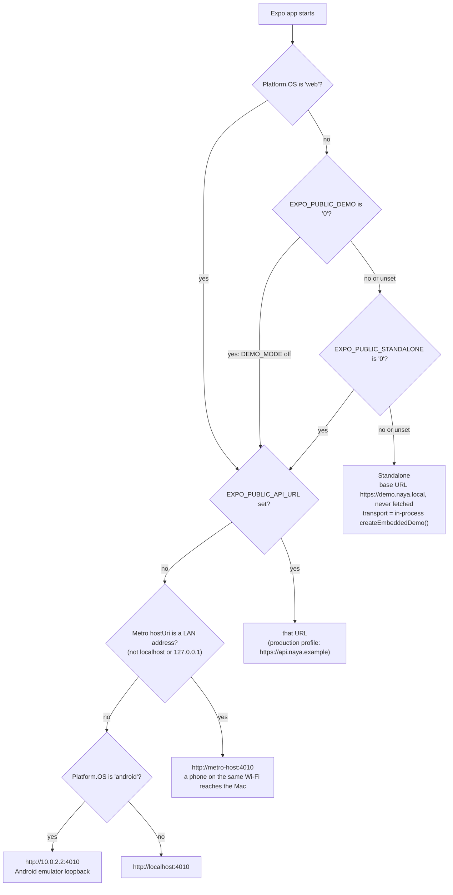

# Runtime modes

Which backend each build talks to, which environment variables decide it, and which env file each process reads.
Owner: not assigned yet (see [docs/README.md](../README.md)).
Last verified: 2026-10-13 against branch `chore/docs-foundation-and-fixes` (based on c38429d).

How to *run* each mode: [runbooks/local-dev.md](../runbooks/local-dev.md),
[runbooks/ios-simulator.md](../runbooks/ios-simulator.md), [runbooks/testflight-eas.md](../runbooks/testflight-eas.md).
Why native demo builds embed the API: [ADR-0012](../adr/0012-native-demo-builds-run-the-demo-api.md).

## The modes

| Mode | How you get it | Who answers API calls | Data lives in | API dev mode | Sees the other roles? |
|---|---|---|---|---|---|
| **Standalone** (native default) | iOS or Android build with `EXPO_PUBLIC_DEMO` and `EXPO_PUBLIC_STANDALONE` both not `'0'` (unset counts as on) | the demo API **inside the app**, through `createEmbeddedDemo()` (`services/demo-api/src/embedded.ts`) | the app's `Documents/naya-standalone-demo/demo-v1.json` | always on (`embedded.ts:18-22`) | No. Each app has its own store; a bot driver, generated offers and an automatic review play the other side |
| **Connected** (native) | native build with `EXPO_PUBLIC_STANDALONE=0`, plus `pnpm api` | the Node demo API, by HTTP | `services/demo-api/.data/db.json` | on unless `NAYA_DEV=0` | Yes: both apps and the admin share one API |
| **Web** | Expo web (`expo start --web`) or the admin | the Node demo API, by HTTP; web is never standalone (`apiBase.ts:5`) | same as connected | same as connected | Yes |
| **Review capture** | connected build with `EXPO_PUBLIC_REVIEW=1` (the runbook uses a Release build) | the Node demo API | same as connected | must be on: the app polls `GET /dev/navigate` | Yes |
| **Production** | `EXPO_PUBLIC_DEMO=0` (EAS `production` profile) | `EXPO_PUBLIC_API_URL`, set to the placeholder `https://api.naya.example` | — | — | Nothing answers today (backlog P18, [ADR-0045](../adr/0045-production-backend-and-live-integrations.md)) |

Two more ways the same `createApp()` runs, for completeness:

- **vitest**: `services/demo-api/test/harness.ts` calls `app.request()` in-process with a `ManualClock`, dev mode on,
  any 6-digit OTP accepted (`setup(s, { devMode: false })` checks the real code) and an in-memory store (no file), and adds an `Idempotency-Key` to every POST unless a test opts out.
- **Playwright e2e**: the `api` entry of `webServer` in `e2e/playwright.config.ts` starts the Node API with
  `NAYA_DEV=1` and `NAYA_DATA_DIR=services/demo-api/.data/e2e`, so the specs' resets never touch your own demo data.
  It reuses a server already running on the URL, and then resets *that* one.

`apps/web` is outside all of this: it calls no API and keeps its data in the browser's `localStorage`
(`naya-web-prototype-v1`).

## How an Expo app picks its backend

The whole decision is in `packages/ui/src/core/apiBase.ts`. `EXPO_PUBLIC_*` values are inlined when Metro
bundles, so changing one needs a new bundle (restart Metro, or rebuild a Release build).

In code:

- `DEMO_MODE = process.env.EXPO_PUBLIC_DEMO !== '0'` (`apiBase.ts:4`).
- `STANDALONE_DEMO = Platform.OS !== 'web' && DEMO_MODE && process.env.EXPO_PUBLIC_STANDALONE !== '0'` (`apiBase.ts:5`).
- `resolveApiBase()` (`apiBase.ts:13-21`) returns the URL. `useMakeClient` (`packages/ui/src/core/Providers.tsx:23-38`)
  passes it to `createApiClient`, and in standalone mode also passes `localDemoOptions(session)`: a `transport` that
  hands each request to the in-process app instead of `fetch` (`packages/ui/src/core/localDemo.native.ts`).

### What else the two flags switch

| Flag | When on | Where |
|---|---|---|
| `STANDALONE_DEMO` | No offline banner; queries and mutations use `networkMode: 'always'` | `Providers.tsx:45`, `packages/ui/src/core/query.ts:9,25,34` |
| | SOS copy: the alert is recorded on the phone (no desk is claimed) instead of « Transmise à l’équipe sécurité Naya » | `packages/ui/src/features/prototype.tsx` (`desk`) |
| | Scenario launcher wording (on-device data instead of the API URL) | `packages/ui/src/features/DevLauncher.tsx` |
| | Driver: no background location task; a fixed position (Rabat) instead of GPS | `apps/driver/src/lib/backgroundLocation.ts:17,43`, `apps/driver/src/lib/location.ts:10-18` |
| | The review navigator stays off | `packages/ui/src/core/DevNavigator.tsx:19` |
| `DEMO_MODE` | Naya Famille: a device without a camera attaches the stand-in proof photo; the WhatsApp hand-off is noted on the trip instead of opened | `packages/ui/src/features/famille/FamilleTripScreen.tsx`, `parts.tsx` |
| | Driver home: « Utiliser ma dernière position connue » when GPS is denied | `apps/driver/src/app/(app)/(tabs)/index.tsx:152` |
| `__DEV__` (not a Naya flag) | The scenario launcher: hidden 2 s long press on the welcome logo, and the `dev` route (release builds redirect it home) | `DevLauncherGesture` in `packages/ui/src/features/DevLauncher.tsx`, `apps/*/src/app/dev.tsx` |

Since 14 Oct 2026 neither flag shows any demo wording ([ADR-0058](../adr/0058-present-the-mock-backed-apps-as-a-real-product.md)):
« Utiliser un compte démo », the welcome « Démo » badge, the Compte « Lanceur de scénarios » row and « Passer · exemple
de démonstration » are gone. In dev mode any 6-digit sign-in code works and the device shows none, and
mock outcomes (provider answers, on-device review) come from the API, not from a flag in the app. The embedded backend is
still bundled into every native build, production included, because `Providers.tsx:18` imports `./localDemo`
unconditionally (backlog P9, UI-04, [ADR-0044](../adr/0044-demo-gating-flag-defaults-and-the-production.md)).

## Defaults are opt-out (today)

A missing variable turns the demo **on**:

| Unset variable | Result |
|---|---|
| `EXPO_PUBLIC_DEMO` | demo UI shown (`DEMO_MODE` true) |
| `EXPO_PUBLIC_STANDALONE` | native builds run standalone |
| `NAYA_DEV` | API dev mode (`services/demo-api/src/main.ts:13`): any 6-digit OTP signs in (`otpMode: 'any'`; no code is returned or shown), `/dev/*` routes registered with no authentication, `POST /provider-sandbox/:kind/:ref/:outcome` and `POST /prototype/wallet/:id/resolve` registered (a payer may settle her own pending payment, recharge or top-up, an admin any provider reference; with `NAYA_DEV=0` they answer 404, API-03), and the Famille demo paths open up: `POST /prototype/family/example`, a passenger advancing her own family trip, the `demo-arrival-photo` proof (`services/prototype.ts`) |
| `NAYA_PROVIDER_SECRET` | `demo-provider-secret-change-me`; accepted only in dev mode — with `NAYA_DEV=0` the server exits (`main.ts:15-20`) |

The Node server also listens on `0.0.0.0` (`main.ts:45`), so anyone on the same network can reach a dev-mode API
(backlog API-06). Making the flags opt-in is [ADR-0044](../adr/0044-demo-gating-flag-defaults-and-the-production.md)
(backlog P9); this table changes when that lands.

## Environment variables

| Variable | Read by | Unset means | Effect |
|---|---|---|---|
| `EXPO_PUBLIC_DEMO` | `packages/ui/src/core/apiBase.ts:4` | demo on | `'0'` turns off `DEMO_MODE` and, with it, standalone |
| `EXPO_PUBLIC_STANDALONE` | `apiBase.ts:5` | standalone on (native only) | `'0'` makes a native demo build use HTTP |
| `EXPO_PUBLIC_API_URL` | `apiBase.ts:15` | Metro host:4010, then `10.0.2.2:4010` (Android), then `localhost:4010` | API base URL; ignored in standalone |
| `EXPO_PUBLIC_REVIEW` | `packages/ui/src/core/DevNavigator.tsx:19`; `apps/*/src/app/(auth)/welcome.tsx:13-14` | off | `'1'`: a connected build polls `GET /dev/navigate` every second; any build shows the welcome slides again with `?preview=1` |
| `EXPO_PUBLIC_MAP_TILE_URL`, `EXPO_PUBLIC_MAP_ATTRIBUTION` | `packages/ui/src/map/TileMap.tsx:23-24` | OpenStreetMap tiles | raster tiles for web and key-less Android |
| `GOOGLE_MAPS_ANDROID_KEY` | `apps/*/app.config.ts:3` | Android uses the tile fallback | written into the native project at prebuild |
| `PORT` | `services/demo-api/src/main.ts:14` | 4010 | Node API port |
| `NAYA_DEV` | `main.ts:13` | dev mode on | `'0'` turns off the any-code sign-in (random code in the log) and `/dev/*` |
| `NAYA_PROVIDER_SECRET` | `main.ts:15` | `demo-provider-secret-change-me` | HMAC secret for `POST /providers/:provider/callback` |
| `NAYA_DATA_DIR` | `main.ts:12`, `services/demo-api/src/cli.ts:8` | `services/demo-api/.data` | where `db.json` and uploads live |
| `NAYA_APPLE_AUTH_CONFIGURED`, `NAYA_GOOGLE_AUTH_CONFIGURED` | `services/demo-api/src/app.ts:246-247` | off | `GET /auth/providers` advertises social sign-in (no verification exists) |
| `VITE_API_URL` | `apps/admin/src/lib/api.ts:5` | `http://localhost:4010` | admin API base URL |
| `NEXT_PUBLIC_MAP_TILE_URL`, `NEXT_PUBLIC_MAP_ATTRIBUTION` | `apps/web/components/map.tsx:28-30` | OpenStreetMap tiles | website map |
| `API_URL`, `PASSENGER_URL`, `DRIVER_URL`, `ADMIN_URL` | `e2e/playwright.config.ts:12-15` | the four local ports | where Playwright points; `webServer` starts what does not answer |
| `CI`, `PLAYWRIGHT_CHROMIUM_EXECUTABLE_PATH` | `e2e/playwright.config.ts` | no retry; Playwright's own Chromium | `CI` set: each failed test is retried once; the path picks another Chromium binary |

There is no `VITE_DEMO` or other flag for the admin: its login page always lists the demo accounts
(`apps/admin/src/pages/Login.tsx:11-14`).

## Which env file each process reads

The root `.env.example` lists the demo API, Expo and admin variables (not `EXPO_PUBLIC_REVIEW`, the `NEXT_PUBLIC_*`
ones or the Playwright URLs), but **no process reads a root `.env`** (backlog QA-09). Each process reads its own:

| Process | Started by | Reads | When |
|---|---|---|---|
| Demo API (Node) | `pnpm api` → `tsx watch src/main.ts` | the shell environment only; no dotenv | at start |
| Demo API (in-process) | the native app | nothing: config is hard-coded in `embedded.ts:18-22` (dev mode, any 6-digit OTP, a fictional provider secret) | — |
| Expo, Metro dev server | `expo start` (`NODE_ENV=development`) | `apps/<app>/.env.development.local`, `.env.local`, `.env.development`, `.env`; the first file in this list that sets a variable wins, and the shell wins over every file (`@expo/env`) | bundle time |
| Expo, Release bundle (Xcode Release, `expo export`) | `NODE_ENV=production` | `apps/<app>/.env.production.local`, `.env.local`, `.env.production`, `.env`. The shell's `EXPO_PUBLIC_*` do not reach an Xcode Release bundle ([ios-simulator.md](../runbooks/ios-simulator.md)) | bundle time |
| EAS build | `eas build --profile <name>` | the profile's `env` in `apps/<app>/eas.json` | build time |
| `app.config.ts` | `expo prebuild`, `expo start` | the shell (`GOOGLE_MAPS_ANDROID_KEY`) | config time |
| Admin (Vite) | `vite`, `vite build` | `apps/admin/.env`, `.env.local`, `.env.[mode]`, `.env.[mode].local`; only `VITE_*` reach the code | dev start or build |
| Website (Next.js) | `next dev`, `next build` | `apps/web/.env*`; only `NEXT_PUBLIC_*` reach the browser | build |
| Playwright | `pnpm e2e` | the shell; passes `NAYA_DEV`, `PORT`, `NAYA_DATA_DIR` to the API it starts, `EXPO_PUBLIC_API_URL` to the Expo web servers and `VITE_API_URL` to the admin | — |

Env files present in the checkout these docs were checked against (2026-10-13): only `apps/passenger/.env.production.local` and
`apps/driver/.env.production.local` (git-ignored), both set to the TestFlight values below. That one file feeds both
review builds and TestFlight archives, so rewrite it before each kind of build
([testflight-eas.md](../runbooks/testflight-eas.md)).

## EAS profiles

`apps/passenger/eas.json` and `apps/driver/eas.json` are identical.

| Profile | `EXPO_PUBLIC_DEMO` | `EXPO_PUBLIC_STANDALONE` | `EXPO_PUBLIC_API_URL` | `EXPO_PUBLIC_REVIEW` | Resulting mode |
|---|---|---|---|---|---|
| `development` (simulator, dev client) | `1` | `0` | `http://localhost:4010` | unset | see note below |
| `development-device` | inherits `development` | | | | see note below; `localhost` would not reach the Mac from a real phone |
| `preview` (internal) | `1` | `1` | unset | `0` | standalone |
| `demo-testflight` (store) | `1` | `1` | unset | `0` | standalone |
| `production` (store) | `0` | unset (ignored once demo is off) | `https://api.naya.example` | unset | production; no backend answers |

The two `development` profiles build a dev client, which loads its JavaScript from your local Metro. `EXPO_PUBLIC_*`
are inlined when Metro bundles (see above), so in those builds the mode follows the environment Metro starts with
(shell and `apps/<app>/.env*`), not this table; the profile's `env` only reaches what runs during the EAS build itself,
such as `app.config.ts`. With nothing set, a dev client on a simulator or phone runs standalone.

No recorded TestFlight upload used EAS; they were local Xcode archives that read `.env.production.local`
([testflight-eas.md](../runbooks/testflight-eas.md)).

## Rules of thumb

- Standalone builds never sync with each other or the admin. To show a passenger → driver → admin loop (SOS, Famille,
  verification review), use connected mode or the web apps against one `pnpm api`.
- A store `schemaVersion` change reseeds every store, including testers' on-device data
  (`services/demo-api/src/store.ts:22-29`, [ADR-0029](../adr/0029-demo-store-is-versioned-schemaversion-1-and.md)).
- Never ship a build that points at `localhost` or at `https://api.naya.example`.
- In a dev-mode API, `/dev/*` routes need no sign-in. Do not expose one beyond your own network.
