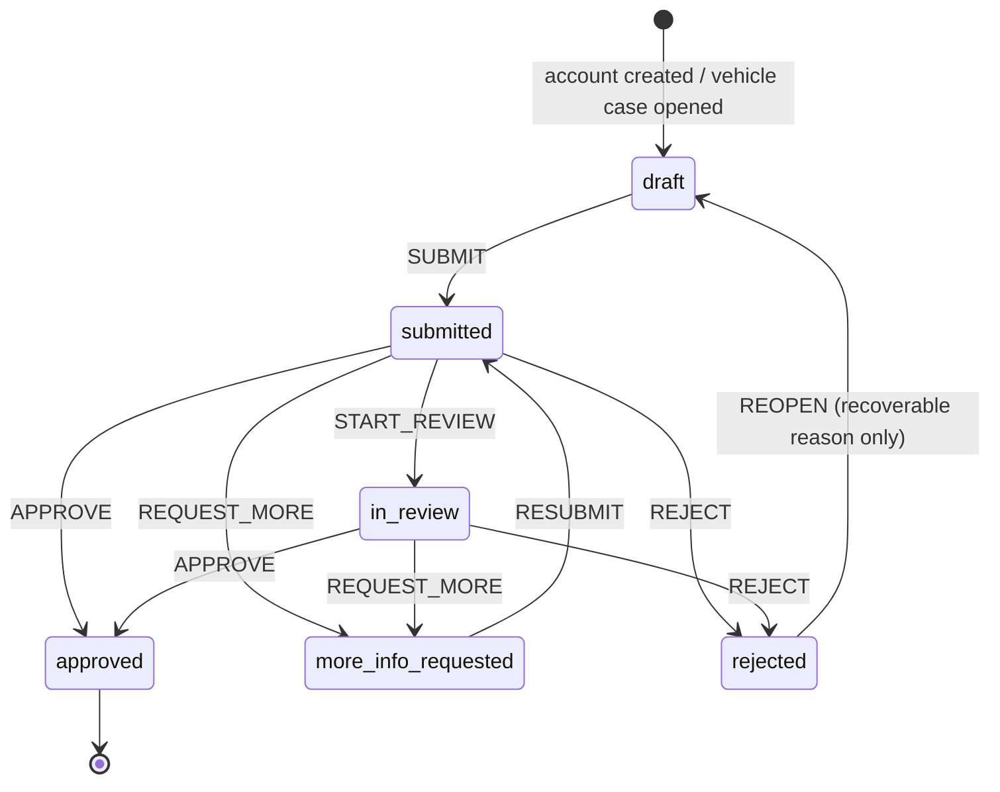

# Eligibility and verification

**Status marks:** ✅ matches intent · ⚠️ known defect (backlog ID) · ❓ open (Proposed ADR). See [_template.md](_template.md).

Line numbers refer to commit `c38429d`.

## Purpose

Who may use Naya and how that is established: the identity review of passagères, the two reviews of chauffeuses (person, vehicle), and what each approval unlocks.

Naya is sold as a women-only service (`README.md:3`). **The code does not define or check that rule anywhere** (R6). It is backlog P6, decision [D1](../status/open-questions.md#d1-women-only-eligibility), and [ADR-0034](../adr/0034-women-only-eligibility-and-verification-policy.md) (Proposed).

Out of scope: sign-in and OTP (planned `specs/accounts-and-auth.md`; until it exists, [ADR-0021](../adr/0021-demo-authentication.md) and [ADR-0058](../adr/0058-present-the-mock-backed-apps-as-a-real-product.md): any valid number signs in or opens an account, and in mock builds the code arrives on the device like a text message, with no « compte démo » shortcut), which service categories a vehicle may serve ([ADR-0043](../adr/0043-category-vehicle-eligibility-and-scooter-scope.md)), Naya Famille children and recipients ([family.md](family.md)), document storage and retention (planned `specs/privacy-and-data.md`).

## Actors

| Actor | Surface | Role |
|---|---|---|
| Passagère | passenger app, `(verify)` route group | Enters identity details, uploads a selfie and her ID, submits, fixes flagged items, restarts after a recoverable refusal. |
| Chauffeuse | driver app, `(onboard)` group and `docs/` routes | Fills two independent dossiers: herself (identity and licence) and her vehicle. |
| Reviewer | apps/admin `/verifications` | `people.read` lists and opens cases. `verification.decide` takes a case, decides, and opens the document files. |
| Demo API | services/demo-api | Stores cases, runs the state machine, enforces every gate below. |
| On-device reviewer (mock) | standalone native builds | Takes a case submitted on the device up after 6 s and approves it 20–40 s after submission; never requests a correction or refuses (`REVIEW_PICKUP_MS`, `reviewDelayMs` in `services/demo-api/src/embedded.ts`; changed 14 Oct 2026, [ADR-0058](../adr/0058-present-the-mock-backed-apps-as-a-real-product.md)). |
| Scenario reviewer (dev mode) | `POST /dev/verification/:id/simulate` (used by the API tests; no app calls it) | A system actor, « Réviseuse de démonstration » (`system:demo-review`), never an admin. Decides the calling chauffeuse's own submitted dossier at once (R20). |

## Rules

### What is collected

**R1 · A passagère's identity case needs her details (first name, last name, birth date, document type, document number) and three items: selfie, ID front, ID back.** ⚠️

- Enforced at: `packages/domain/src/machines/verification.ts:16-17` (`REQUIRED_ITEMS`), `:41-51` (`assertSubmittable`); `packages/domain/src/schemas.ts:56-62` (`identityDetailsSchema`).
- Tested by: `packages/domain/test/machines.test.ts:63` "requires every piece before submission"; `services/demo-api/test/scenarios.test.ts:34` (S01) "new passenger submits identity; submission is not approval; admin approves".
- Gap: the back side is required even for a passport (DOM-06).

**R2 · A chauffeuse's person case needs the same details and four items (selfie, ID front, ID back, driving licence). Her vehicle case needs make, model, colour, plate and year, and three items: registration (carte grise), insurance certificate, vehicle photos.** ✅

The founder brief asks for more data and documents; see [Proposed additions](#proposed-additions-founder-brief-13-oct-pending-confirmation).

- Enforced at: `packages/domain/src/machines/verification.ts:18-19`; `packages/domain/src/schemas.ts:64-70` (`vehicleDetailsSchema`); `services/demo-api/src/services/verification.ts:42-70` (`ensureVehicleCase`, drivers only).
- Tested by: `services/demo-api/test/scenarios.test.ts:337` (S10) "new driver creates person and vehicle cases separately".
- Gap: no licence number, category or dates, and no vehicle type (P17, [ADR-0043](../adr/0043-category-vehicle-eligibility-and-scooter-scope.md)). No expiry date on any document (DOM-07).

**R3 · Applicants are 18 or older on the day they save their details. Vehicles are from 2012 or later.** ✅

- Enforced at: `packages/domain/src/schemas.ts:48-54` (`isAdult`), `:59`, `:69`.
- Tested by: **not tested** directly.

**R4 · A file is accepted only when its bytes match the declared type (JPEG, PNG, WebP or PDF; SVG refused) and it is at most 10 MB. Only the uploader can attach it, and only to her own case.** ✅

- Enforced at: `services/demo-api/src/services/uploads.ts:7`, `:10-17` (`sniff`), `:29-35`; `services/demo-api/src/services/verification.ts:34-38` (`ownedCase`), `:100-103`.
- Tested by: `services/demo-api/test/scenarios.test.ts:69` (S01) "rejects uploads whose bytes are not the declared image type".

**R5 · Saving identity details copies the first and last name onto the account.** ✅

- Enforced at: `services/demo-api/src/services/verification.ts:84-88`.
- Tested by: **not tested** directly.

### Women-only eligibility

**R6 · No rule in the code establishes that a passagère or a chauffeuse is a woman.** ⚠️ ❓

The promise exists only in copy: `README.md:3`; the help answer « Naya est réservé aux femmes. » (`apps/passenger/src/features/help/topics.ts:38`); the welcome slides « entre femmes » (`apps/passenger/src/app/(auth)/welcome.tsx:7`, `apps/driver/src/app/(auth)/welcome.tsx:7`).

Nothing in the data or the decision carries it:

1. `IdentityDetails` has no field for it (`packages/domain/src/entities.ts:100-106`), and neither has the schema (`packages/domain/src/schemas.ts:56-62`).
2. The decision records the outcome, the reason code, the message, and who decided and when; nothing about eligibility (`packages/domain/src/entities.ts:116-125`).
3. The reviewer checklist has three lines, none about eligibility: « Vérifier la lisibilité de chaque pièce », « Vérifier la correspondance des informations », « Motiver toute demande ou tout refus ». They are static text, not boxes the reviewer ticks, and nothing is stored (`apps/admin/src/pages/CaseReview.tsx:152-156`).
4. The only fitting refusal is the generic `not_eligible`, « Conditions d’inscription non remplies » (`services/demo-api/src/services/verification.ts:27`).

- Enforced at: nowhere.
- Tested by: **not tested**.
- Gap: P6, PRD-34, DOC-06. What the rule must settle is listed under [Open questions](#women-only-rule-d1-adr-0034).

**R7 · Nothing is inferred from appearance. A person compares the selfie with the document.** ✅

- Enforced at: by absence. No face or gender inference exists in the code, by design ([ADR-0019](../adr/0019-verification-is-a-manual-human-review-with.md); `docs/INTEGRATIONS.md:10` at `c38429d`, replaced on this branch by [status/integrations.md](../status/integrations.md#sign-in-and-identity)). The copy says so: « Aucun jugement n’est fait sur l’apparence. » (`apps/admin/src/pages/CaseReview.tsx:105`); « Le selfie sert uniquement à comparer avec votre pièce. » (`apps/driver/src/app/docs/capture/[item].tsx:10`).
- Tested by: **not testable** in code today.
- Gap: the rule lives in an ADR and in copy, not in the eligibility policy itself ([ADR-0034](../adr/0034-women-only-eligibility-and-verification-policy.md)).

### Review and decision

**R8 · Submission is not approval. Submitting moves a complete case to `submitted`; only an admin with `verification.decide` can approve it, ask for more, or refuse it.** ✅

The one exception is the dev-mode scenario reviewer for chauffeuses, a system actor that no admin signs for (R20).

- Enforced at: `services/demo-api/src/services/verification.ts:118-140` (`submitCase`), `:158-159` and `:174-175` (`requirePermission`); `packages/domain/src/machines/verification.ts:7-14`.
- Tested by: `packages/domain/test/machines.test.ts:56` "submission is not approval; correction loops back through submission"; `services/demo-api/test/scenarios.test.ts:34` (S01); `:108` (S02) "support agents cannot decide identity cases"; `e2e/tests/passenger-flows.spec.ts:34` (S01); `e2e/tests/admin-verifications.spec.ts:6` (S01).

**R20 · In dev mode, a chauffeuse's own submitted dossier can be decided at once by a scenario reviewer. A system actor decides, never an admin, and passagères cannot use it.** ✅ ❓

The route is `POST /dev/verification/:id/simulate`, registered only in dev mode. The API tests use it; no app calls it since 14 Oct 2026 (before, the driver app offered « Démo » outcome buttons; [ADR-0058](../adr/0058-present-the-mock-backed-apps-as-a-real-product.md)). The reviewer is the system actor « Réviseuse de démonstration » (`system:demo-review`). It is the name on the decision (`decidedBy`, `decidedByName`), in the case history and in the audit trail. The audit actions are `verification.simulated_approved`, `verification.simulated_more_info_requested` and `verification.simulated_rejected`, with a summary that starts « Démo · examen simulé », so a simulation never counts as an admin's `verification.approved`. The messages the chauffeuse reads are the ones a reviewer would write, with no demo wording (ADR-0058). A passagère gets 403, another chauffeuse's dossier 403, and a dossier not yet sent 409.

- Enforced at: `services/demo-api/src/app.ts` (`userOf(c, 'driver')` on the route, inside the `ctx.config.devMode` block); `services/demo-api/src/services/verification.ts` (`simulateReview`, `DEMO_REVIEWER`, `applyDecision`).
- Tested by: `services/demo-api/test/signup.test.ts` "the scenario reviewer can approve, request a correction or refuse the caller’s own dossier" and "decides as a labelled system reviewer, never in an admin’s name, and refuses passengers (DS-1)".
- Gap: dev mode is on unless `NAYA_DEV=0`, so the route is live on any demo server that does not set it (P9, [ADR-0044](../adr/0044-demo-gating-flag-defaults-and-the-production.md), decision [D9](../status/open-questions.md#d9-demo-runtime-and-hosting)). The automatic approval of standalone builds (the on-device reviewer in [Actors](#actors)) still decides in the name of an admin with `verification.decide` (`services/demo-api/src/embedded.ts`).

**R9 · Any admin with `people.read` can list and open cases. Only `verification.decide` can open the document files (the owner can too).** ✅

- Enforced at: `services/demo-api/src/app.ts:715-745` (queue and detail need `people.read`; `canDecide` at `:743`); `services/demo-api/src/services/uploads.ts:53-65` (`readUpload`).
- Tested by: `services/demo-api/test/scenarios.test.ts:60-61` (S01: another user gets 403, the admin gets 200).
- Gap: viewing a document writes no audit entry, although the viewer says « accès journalisé côté serveur » (`apps/admin/src/components/DocViewer.tsx:44`; ADM-19).

**R10 · A decision applies only to the case version the reviewer opened.** ✅

- Enforced at: `services/demo-api/src/services/verification.ts:178-180` (`CONFLICT`); `apps/admin/src/pages/CaseReview.tsx:43`, `:50-55`, `:92-96` (reload banner).
- Tested by: `services/demo-api/test/scenarios.test.ts:78` (S02) "more info → corrected piece → resubmitted → approved; stale decisions conflict".

**R11 · « Demander un complément » names at least one item with an instruction. Every decision other than approval carries a message of 10 characters or more, shown to the applicant.** ✅

- Enforced at: `packages/domain/src/schemas.ts:136-151` (`decisionSchema`); `services/demo-api/src/services/verification.ts:184-192`; `apps/admin/src/pages/CaseReview.tsx:72-80`.
- Tested by: `services/demo-api/test/scenarios.test.ts:95` (S02, empty message refused); `e2e/tests/admin-verifications.spec.ts:18` (S02).

**R12 · A refusal carries a reason code from the fixed list.** ⚠️

The admin requires one (`apps/admin/src/pages/CaseReview.tsx:73`). The server accepts `null` or any string (`packages/domain/src/schemas.ts:139`; stored as is at `services/demo-api/src/services/verification.ts:196`). A refusal with no known code cannot be restarted (R14). The admin itself sends `correction`, a code outside the list, with every « Demander un complément » (`apps/admin/src/pages/CaseReview.tsx:40`).

- Enforced at: client only.
- Tested by: **not tested** on the server. The S02 refusal test checks the message rule, not the code.
- Gap: no backlog ID yet (found while writing this spec).

**R13 · The approval message is shown to the applicant.** ⚠️

The admin labels the field « Note interne (facultative) » (`apps/admin/src/pages/CaseReview.tsx:256`). It is stored as `decision.message`, defaulting to « Votre dossier a été validé. » (`services/demo-api/src/services/verification.ts:193-196`), and the passenger app prints it under « Bienvenue sur Naya » (`apps/passenger/src/app/(verify)/verification-status.tsx:49`).

- Enforced at: `services/demo-api/src/services/verification.ts:193-196`; `apps/passenger/src/app/(verify)/verification-status.tsx:49`.
- Tested by: **not tested**.
- Gap: ADM-07.

**R14 · The applicant can restart only after a refusal for `document_expired`, `document_unreadable` or `identity_mismatch`. Restarting empties every item. Any other refusal, `not_eligible` included, sends her to support.** ⚠️ ❓

- Enforced at: `services/demo-api/src/services/verification.ts:20-21` (`RECOVERABLE_REJECTIONS`), `:142-156` (`reopenCase`); `apps/passenger/src/app/(verify)/verification-status.tsx:71-85`; the driver app offers « Recommencer » or « Assistance » per dossier the same way (`apps/driver/src/components/Dossier.tsx:204-216`).
- Tested by: `services/demo-api/test/scenarios.test.ts:95` (S02) "refusal requires a reason; a recoverable refusal can be restarted"; `e2e/tests/passenger-flows.spec.ts:67` (S02).
- Gap: no appeal path after an eligibility refusal ([ADR-0034](../adr/0034-women-only-eligibility-and-verification-policy.md)).

**R15 · Every submission and every decision writes an audit entry; decisions record the status before and after.** ✅

- Enforced at: `services/demo-api/src/services/verification.ts:130-137`, `:202-217`.
- Tested by: `services/demo-api/test/scenarios.test.ts:65-66` (S01, `verification.approved` in the audit log).
- Gap: taking a case for review and restarting it are written only to the case history (`:167`, `:153`). Document views are not audited (ADM-19).

### What approval unlocks

**R16 · A passagère can book a ride or subscribe to Naya Famille only once her identity case is approved.** ✅

- Enforced at: `services/demo-api/src/services/rides.ts:134-137` (`requireVerifiedPassenger`), called at `:194` (booking) and `:718` (scheduled booking); `services/demo-api/src/services/prototype.ts:292-297` (Famille subscription). The app keeps her in the `(verify)` group until then (`apps/passenger/src/app/_layout.tsx:16-33`, [ADR-0015](../adr/0015-route-group-gating-with-expo-router-stack.md)).
- Tested by: `services/demo-api/test/scenarios.test.ts:52` (S01, `VERIFICATION_REQUIRED`); `e2e/tests/deeplinks-passenger.spec.ts:14` "unverified passenger: /trips redirects to the verification status".

**R17 · A chauffeuse opens the dashboard once both dossiers are submitted. She can go online and accept offers only when her account is active, both cases are approved, her city is open to her, and her debt is under the city limit.** ✅

- Enforced at: `apps/driver/src/app/_layout.tsx:21-34` (dashboard gate); `services/demo-api/src/services/rides.ts:215-231` (`driverEligibility`), `:299-305` (going online), `:368-369` (accepting), `:262` (dispatch).
- Tested by: `services/demo-api/test/scenarios.test.ts:322` (S10) "person approved + vehicle pending cannot go online; approving the vehicle unlocks"; `e2e/tests/driver-flows.spec.ts:114` (S10); `e2e/tests/admin-verifications.spec.ts:44` (S10). `packages/domain/test/machines.test.ts:66` tests the domain helper `isDriverVerified`, which the server does not call.
- Gap: category eligibility is checked in dispatch (`:262`) and on accept (`:370`) but missing from `driverEligibility`, so the status endpoint can report `eligible: true` while no offer arrives (API-16, P17).

**R18 · An approval does not expire and cannot be revoked.** ⚠️ ❓

- Enforced at: `packages/domain/src/machines/verification.ts:13` (`approved: {}`). No expiry fields exist (`packages/domain/src/entities.ts:100-114`). The only lever is the account status `suspended` (`packages/domain/src/entities.ts:39`), and nothing sets it (API-14).
- Gap: DOM-07; [ADR-0055](../adr/0055-account-lifecycle.md).

**R19 · After approval, the account holder can still change her name and her city, with no review and no audit.** ⚠️

- Enforced at: `services/demo-api/src/app.ts:257-271` (`PATCH /me`).
- Gap: API-12.

## States and transitions

Machine: `verificationMachine` (`packages/domain/src/machines/verification.ts:7-14`), applied by `services/demo-api/src/services/verification.ts`.

| State (label) | Event | Next | Who | Side effects |
|---|---|---|---|---|
| — | account created | `draft` | demo API | The identity case is created at sign-up (`services/demo-api/src/services/auth.ts:81-116`); the vehicle case on demand (`services/demo-api/src/services/verification.ts:42-70`). |
| `draft` (« À compléter ») | SUBMIT | `submitted` | applicant | Needs a complete case (R1, R2). Audit `verification.submitted`. |
| `submitted` (« Envoyé ») | START_REVIEW | `in_review` | `verification.decide` | Case history only. No effect in any other state (`services/demo-api/src/services/verification.ts:162`). |
| `submitted`, `in_review` | APPROVE | `approved` | `verification.decide` | Items become `accepted`. Audit. |
| `submitted`, `in_review` | REQUEST_MORE | `more_info_requested` | `verification.decide` | Named items become `needs_correction` with the instruction; the others `accepted`. Audit. |
| `submitted`, `in_review` | REJECT | `rejected` | `verification.decide` | Items unchanged. Audit. |
| `more_info_requested` (« Complément demandé ») | RESUBMIT | `submitted` | applicant | Audit `verification.resubmitted`. |
| `rejected` (« Refusé ») | REOPEN | `draft` | applicant | Recoverable reason only (R14). Every item reset to `missing`. Case history only. |
| `approved` (« Approuvé ») | — | — | — | Terminal (R18). |

Items (`packages/domain/src/entities.ts:92-98`): `missing` → `provided` on upload (`services/demo-api/src/services/verification.ts:105-111`) → `accepted` or `needs_correction` on a decision (`:185-192`) → `provided` again. Details and items can change only in `draft` and `more_info_requested` (`:40`). Status labels: `packages/domain/src/machines/verification.ts:32-39`.

## Proposed additions (founder brief 13 Oct, pending confirmation)

Task 2 of the [founder brief](../tasks/2026-10-13.md) lists what driver sign-up should collect. The founder answered on 13 Oct that the criminal-record extract is for Naya Famille drivers only ([F3](../status/open-questions.md#f3-criminal-record-extract-scope)); the rest of the list is not confirmed item by item.

| Brief asks for | Today | Status |
|---|---|---|
| Full name, date of birth | `firstName`, `lastName`, `birthDate` (18+) | exists |
| CIN number | `documentNumber`, with `documentType` CIN, passport or residence permit (`packages/domain/src/entities.ts:104-105`) | exists |
| Address | nothing | missing |
| City | `User.cityId`, set to `rabat` at sign-up (`services/demo-api/src/services/auth.ts:90`), editable through `PATCH /me` (R19); not part of the case | outside the case |
| Licence number, category (B), issue date, expiry date, years of driving | nothing | missing |
| Licence photos, front and back | one item, `driving_licence` « Permis de conduire » | partial |
| CIN front and back, selfie | `id_front`, `id_back`, `selfie` | exists |
| Criminal-record extract (fiche anthropométrique / extrait de casier judiciaire) | nothing | missing; Naya Famille drivers only, per the founder's answer to [F3](../status/open-questions.md#f3-criminal-record-extract-scope) (not yet in an ADR) |
| Registration (carte grise), insurance certificate | `vehicle_registration`, `insurance` (no expiry) | exists |
| Technical inspection (visite technique) | nothing | missing |
| Vehicle photos | `vehicle_photos` | exists |
| Per-document status: missing → submitted → in review → approved / rejected with reason, one progress view | Items are `missing`, `provided`, `accepted`, `needs_correction` (`packages/domain/src/entities.ts:95`). Review and refusal apply to the whole case; the reason code is per case. | different model |
| UI: one question per step, real progress, save-and-resume, camera guides, readable rejection reasons | Progress in the capture header (`apps/driver/src/app/docs/capture/[item].tsx:34`), one guidance line per item (`:9-17`), each item saved on the server as it is uploaded (`services/demo-api/src/services/verification.ts:96-116`) | redesign requested |

Before building these:

- New items extend `VerificationItemKey` and `REQUIRED_ITEMS`. New fields change the persisted case shape, and a store mismatch reseeds from fixtures, wiping TestFlight data ([ADR-0029](../adr/0029-demo-store-is-versioned-schemaversion-1-and.md)).
- Expiry dates are only useful once approvals can expire or be revoked (R18, [ADR-0055](../adr/0055-account-lifecycle.md)).
- Stricter Naya Famille vetting (brief task 4) is specified in [family.md](family.md#requested-founder-brief-13-oct).

## Demo vs live

| Aspect | Demo today | Live needs |
|---|---|---|
| Documents | Fictitious fixtures in the seed (`services/demo-api/src/seed.ts`). Since 14 Oct 2026 there is no « Passer » shortcut: every piece is taken with the camera or imported (`packages/ui/src/features/capture.tsx`), and the admin describes the pieces as « Pièces transmises avec la demande. » (`apps/admin/src/pages/CaseReview.tsx`) with no « fictifs » wording ([ADR-0058](../adr/0058-present-the-mock-backed-apps-as-a-real-product.md)). Before that date: with the demo flag on, each capture step offered « Passer · exemple de démonstration », which attached a fictional specimen (`packages/ui/src/features/capture.tsx:82-90`, `:160-161` at `c38429d`), and the admin said « Documents et selfies fictifs · aucune identité réelle. » | Encrypted KYC storage with a retention policy and a CNDP declaration ([status/integrations.md](../status/integrations.md#sign-in-and-identity); [ADR-0045](../adr/0045-production-backend-and-live-integrations.md)). |
| Review | Manual in apps/admin when the app talks to the demo API. In dev mode the API tests can also have a chauffeuse's own dossier decided at once by the system actor « Réviseuse de démonstration », audited as `verification.simulated_*` (R20). Standalone native builds have an on-device reviewer: « Vérification en cours » after 6 s, approval 20–40 s after submission, with no « simulée » message (`services/demo-api/src/embedded.ts`; tested by `services/demo-api/test/embedded.test.ts:47`). Before 14 Oct 2026 it approved after 3 s with « Validation simulée pour cette démonstration sur votre appareil. » | Staffed reviewers. The apps promise « moins de 24 h » (`apps/passenger/src/app/(verify)/verification-status.tsx:100`) and « moins de 24 h ouvrées » (`apps/driver/src/app/docs/status.tsx:14`). |
| Authenticity | No check that a document is genuine, no liveness, no face match. | A KYC vendor or a written manual procedure (audit section 8.3). |
| Women-only rule | Not checked (R6). | The ADR-0034 policy, with a legal opinion for Morocco. |

Integration status per capability: [status/integrations.md](../status/integrations.md).

## Open questions

### Women-only rule (D1, ADR-0034)

Tracked as [D1](../status/open-questions.md#d1-women-only-eligibility). Today's behaviour: nothing (R6). The rule must pin down:

1. **Evidence.** What shows eligibility: the identity document the reviewer reads, a self-declaration at sign-up plus that check, or a field read by a KYC vendor (D1 options a, b, c). Audit default: (a), a mandatory "eligibility confirmed" item the reviewer ticks on every decision.
2. **Record.** Where the reviewer's confirmation is stored (decision and audit entry). Today there is no field for it (`packages/domain/src/entities.ts:116-125`).
3. **Data kept.** Whether a sex marker is stored at all, who sees it and for how long ([ADR-0018](../adr/0018-sensitive-data-minimisation.md); CNDP, law 09-08).
4. **Refusal.** A dedicated reason code and the words the person reads, instead of the generic `not_eligible`.
5. **Appeal.** Who reviews an eligibility refusal, how fast, and how the outcome is recorded (R14).
6. **No inference.** State in the policy itself that nothing is inferred from appearance (R7).
7. **Scope.** Passagères, chauffeuses, and the people Naya Famille carries or hands over to: children (boys included? up to what age?) and authorised recipients. The demo seeds a « Père » recipient (`services/demo-api/src/services/prototype.ts:592-597`). Audit default for D1: an adult man may be a handover recipient, never a rider. See [family.md](family.md).
8. **Companions.** The website says children travelling with their mother are welcome (`apps/web/components/landing.tsx:40`); rides have no companion model.
9. **Later findings.** What happens when an approved account turns out to be ineligible. This needs revocation (R18).
10. **Legal review.** A written opinion for Morocco before launch (audit D1).

### Other open points

- Expiry and revocation of approvals (licence, insurance), and account suspension: today approval is final (R18). [ADR-0055](../adr/0055-account-lifecycle.md).
- Which profile fields lock after approval, and whether a driver's city change needs an admin: today anything goes (R19). No ADR yet; [ADR-0055](../adr/0055-account-lifecycle.md) is the closest.
- Which service categories a vehicle may serve, derived from a vehicle type: today every driver gets every category (P17). [ADR-0043](../adr/0043-category-vehicle-eligibility-and-scooter-scope.md).
- How the criminal-record extract is collected and checked for Naya Famille drivers (the founder's answer to [F3](../status/open-questions.md#f3-criminal-record-extract-scope): Famille only), its legal basis (D10), and the rest of the stricter Famille vetting (brief tasks 2 and 4). [ADR-0036](../adr/0036-naya-famille-operating-model.md).

## Last verified

`2026-10-13 @ c38429d`, AI session.

- Read at `c38429d`: `packages/domain/src/machines/verification.ts`, `entities.ts`, `schemas.ts`; `services/demo-api/src/services/verification.ts`, `uploads.ts`, `auth.ts`, `rides.ts`, `prototype.ts`, `src/app.ts`, `src/embedded.ts`; `apps/admin/src/pages/CaseReview.tsx`; the passenger `(verify)` routes and root layout; the driver `docs/` routes, root layout, `components/DossierHub.tsx` and `components/Dossier.tsx`; `packages/ui/src/features/capture.tsx`; `apps/admin/src/components/DocViewer.tsx`; the tests cited above; `docs/tasks/2026-10-13.md` task 2.
- Searched with `git grep` at `c38429d` for `gender`, `sex`, `women`, `femme` and `female` in `packages`, `services` and the three apps: only copy matched (R6).
- Run on 2026-10-13 on branch `chore/docs-foundation-and-fixes` (fact-check pass): `vitest run test/scenarios.test.ts` in `services/demo-api` and `vitest run test/machines.test.ts` in `packages/domain`, both passing. Not run: `embedded.test.ts`, jest-expo and the Playwright specs; those are cited by file, line and name only.
- 2026-10-14, branch `fix/demo-blockers-portable` (DS-1 of the [14 October verification](../audits/2026-10-14-verification.md)): R20 added and R8 amended against that branch. R20 cites files and functions, not line numbers. Run: `pnpm --filter @naya/demo-api test`.
- Branch `chore/docs-foundation-and-fixes` changes no verification rule. Its related edits: the empty or incomplete birth-date message in `identityDetailsSchema` now reads « Saisissez votre date de naissance (JJ / MM / AAAA). » instead of « Format AAAA-MM-JJ » (`packages/domain/src/schemas.ts:59`); the driver's `DateField` keeps typed digits and flags impossible dates (P13, `packages/ui/src/Form.tsx`); and dark-mode styling only in `verification-status.tsx`, `DocumentPicker.tsx` and the capture guide frame (`packages/ui/src/features/capture.tsx`). Re-checked against the branch on 2026-10-13 (docs reconciliation).
