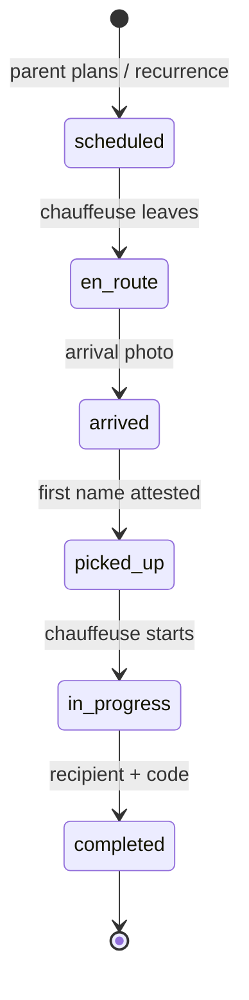

# Naya Famille

**Status marks:** ✅ matches intent · ⚠️ known defect (backlog ID) · ❓ open (Proposed ADR). See [_template.md](_template.md).

Line numbers refer to commit `c38429d`, except where a line says **(branch)**: those refer to branch `chore/docs-foundation-and-fixes` as checked on 2026-10-13, which changed the handover rules (R7, R13, R15) and moved lines in `services/demo-api/src/services/prototype.ts` and `packages/ui/src/features/prototype.tsx`.

> **14 Oct 2026 ([ADR-0058](../adr/0058-present-the-mock-backed-apps-as-a-real-product.md)).** The apps present Naya
> Famille as a real service: Salma's family (Lina, plan Famille Essentiel, Amina, a weekday school trip, codes 1234 and
> 5678) is seeded in every scenario (`MOCK_FAMILIES` in `services/demo-api/src/seed.ts`); there is no « Charger
> l’exemple de démo » button; proof buttons read « Prendre une photo » (a device without a camera attaches a stand-in,
> shown to the parent as a photo from `packages/assets/mock/`); bot steps and timeline lines carry no « simulation » or
> « (démo) » marker (old lines are shown without it, `timelineLabel` in `packages/ui/src/features/famille/parts.tsx`).
> The rules below were written at `c38429d`, before the Famille module moved to `services/demo-api/src/services/famille.ts`
> and `packages/ui/src/features/famille/` (parent approval, live position, drop-off photo); re-check them against
> that code before relying on a line number.

## Purpose

A parent's subscription that gives her child a dedicated chauffeuse for planned, recurring trips, with a proof at each step and a handover to an authorised person. It answers client feedback item 2 (`docs/MOBILE-FEEDBACK-AUDIT.md:20`), and the [founder brief](../tasks/2026-10-13.md) (task 4) asks to extend it.

Today it is a demo feature outside payments, dispatch and any written policy (P16). Whether it launches, and how, is decision [D3](../status/open-questions.md#d3-naya-famille-at-launch) ([ADR-0036](../adr/0036-naya-famille-operating-model.md), Proposed).

Out of scope: the parent's own identity review ([eligibility-and-verification.md](eligibility-and-verification.md)), SOS on a family trip ([safety-sos.md](safety-sos.md)).

## Actors

| Actor | Surface | Role |
|---|---|---|
| Parent | passenger app, Compte → « Naya Famille » (`apps/passenger/src/app/(app)/(tabs)/account.tsx:35`) | A passagère with an approved identity. Subscribes, adds children, plans trips, follows the timeline. |
| Child | a profile, not an account | First name, age, school, notes, authorised recipients. |
| Authorised recipient | a name on the child's profile, not an account | Receives the child at the end of the trip by giving a 4-digit code. |
| Dedicated chauffeuse | driver app, Compte → « Naya Famille », screen « Mes familles » (`apps/driver/src/app/(app)/(tabs)/account.tsx:45`; `packages/ui/src/features/prototype.tsx:344`) | Runs each trip step by step. |
| Admin with `config.edit` | apps/admin « Services et familles » → « Familles » (`apps/admin/src/pages/Prototype.tsx:301-377`) | Sees subscriptions, trips, timelines, arrival photos and incidents; reassigns the chauffeuse. Edits the plans in the catalog tabs of the same page (R1). |
| Demo API | `services/demo-api/src/services/prototype.ts` | Stores all of it and checks each step. |

## Rules

### Plans and subscription

**R1 · Two monthly plans: « Famille Essentiel », 590 MAD for 30 days and 20 trips; « Famille Confiance », 990 MAD for 30 days and 40 trips. An admin with `config.edit` can edit them.** ❓

- Enforced at: `packages/domain/src/prototype.ts:224-253` (defaults); `services/demo-api/src/services/prototype.ts:51-59` (`planSchema`), `:890-924` (catalog edit).
- Tested by: **not tested**.
- Gap: prices and quotas are not backed by any decision ([ADR-0036](../adr/0036-naya-famille-operating-model.md)). Catalog edits take no reason and no version check (ADM-09).

**R2 · Only a passagère with an approved identity can subscribe, and she can hold one active subscription at a time. Subscribing charges nothing.** ⚠️ ❓

- Enforced at: `services/demo-api/src/services/prototype.ts:292-297` (approved identity), `:320-325` (« Vous avez déjà un abonnement actif. »), `:343-350` (audit « Abonnement famille activé · paiement simulé »). A new subscription overwrites the previous record (`:341`).
- Tested by: **not tested** directly; the dev-mode example subscribes (`services/demo-api/test/prototype.test.ts:146`).
- Gap: P16, DOM-16, PRD-03.

**R3 · The dedicated chauffeuse is the first active driver in the parent's city whose identity and vehicle are approved. There is no Famille-specific vetting, and no check of her availability, debt or categories.** ⚠️ ❓

- Enforced at: `services/demo-api/src/services/prototype.ts:303-319`. Admin reassignment applies the same test and moves the parent's scheduled trips to the new chauffeuse (`:949-998`). The admin dropdown lists every driver of the city and reassigns as soon as the selection changes (`apps/admin/src/pages/Prototype.tsx:314-328`).
- Tested by: **not tested**.
- Gap: API-17, ADM-10. Stricter vetting is [requested](#requested-founder-brief-13-oct) (item 6).

### Children, recipients and handover codes

**R4 · A child has a first name, an age from 1 to 17, a school, notes, and 1 to 8 authorised recipients, each with a name, a relationship and a 4-digit handover code. The parent's form adds one recipient per child, with the relationship « Responsable ».** ⚠️

- Enforced at: `services/demo-api/src/services/prototype.ts:74-92` (`childSchema`), `:521-532` (create); `packages/ui/src/features/prototype.tsx:442-471` (form).
- Tested by: **not tested** directly.
- Gap: a child or a recipient cannot be edited, removed or revoked (PRD-39).

**R5 · Who may be a child or a recipient is not defined. The dev-mode example adds an adult man, « Père », as a recipient.** ❓

- Enforced at: nowhere. Example: `services/demo-api/src/services/prototype.ts:585-598`. The website welcomes children only as companions of their mother: « Les enfants accompagnés de leur mère sont également les bienvenus. » (`apps/web/components/landing.tsx:40`).
- Tested by: **not tested**.
- Gap: DOC-06, VIS-19; D1 and D3 ([ADR-0034](../adr/0034-women-only-eligibility-and-verification-policy.md), [ADR-0036](../adr/0036-naya-famille-operating-model.md)).

**R6 · Handover codes are fixed per recipient, stored in plain text and compared as typed. The parent sees them; so does any admin with `config.edit`.** ⚠️

- Enforced at: `services/demo-api/src/services/prototype.ts:85-88` (4 digits), `:705` (plain comparison), `:877-888` (`GET /admin/prototype` returns every child with its codes); `packages/ui/src/features/prototype.tsx:733-741` (« Code démo à communiquer : » on the parent's trip card).
- Tested by: `services/demo-api/test/prototype.test.ts:174-191` (wrong code refused, right code accepted).
- Gap: P1 (hashed, one-time per trip), PRD-29; [ADR-0036](../adr/0036-naya-famille-operating-model.md).

**R7 · The chauffeuse never receives a handover code.** ✅

She gets each recipient's id, name and relationship only; the parent keeps her codes, and only the server compares them. At `c38429d` she received whole child objects, codes included (`services/demo-api/src/services/prototype.ts:250-257`).

- Enforced at (branch): `family()` (`services/demo-api/src/services/prototype.ts:272-306`); `FamilyChildView` (`packages/domain/src/prototype.ts:63-69`), the type of `FamilyOverview.children`.
- Tested by (branch): `services/demo-api/test/prototype.test.ts:238` "never sends handover codes to the driver, while the parent keeps hers" (every driver response, serialized, contains no code).
- Gap: closed for the API (P1 first half, API-01, DOM-02, PRD-01, VIS-04). In standalone builds the whole store, codes included, is on the phone (R6).

### Planning and recurrence

**R8 · The parent plans a trip for her own child, in the future, inside the subscription period and within the included-trip quota. The trip goes to the subscription's chauffeuse.** ✅

- Enforced at: `services/demo-api/src/services/prototype.ts:542-560` (route, future time `:553-554`, idempotent), `:353-427` (`addTrip`: active subscription `:366-373`, period `:374-378`, own child `:379-383`, quota `:384-395`).
- Tested by: `services/demo-api/test/prototype.test.ts:142` (through the dev-mode example).

**R9 · The addresses the parent types are labels only. Every trip runs between the Hay Riad and Agdal coordinates.** ⚠️

- Enforced at: `packages/ui/src/features/prototype.tsx:549-560`. Date and time are free-text fields (`:508-517`).
- Tested by: **not tested**.
- Gap: PRD-09, VIS-09.

**R10 · When a trip completes, the next one is created on the next selected weekday, while the subscription lasts and the quota allows. Weekdays are computed in UTC.** ⚠️

- Enforced at: `services/demo-api/src/services/prototype.ts:731-760`.
- Tested by: `services/demo-api/test/prototype.test.ts:192-195`.
- Gap: weekdays must follow Africa/Casablanca ([ADR-0020](../adr/0020-french-only-product-mad-africa-casablanca-business.md)). A trip that never completes ends the series, and the parent cannot cancel or move a trip (DOM-17, API-26).

### Trip steps and proofs

**R11 · Only the trip's chauffeuse moves it forward, one step at a time, from the status she last saw. In dev mode the parent can play her steps.** ✅

- Enforced at: `services/demo-api/src/services/prototype.ts:650-667` (her trip; parent only in dev mode `:659-660`; stale status refused `:661-665`). At `c38429d` the parent's card said « Simuler les étapes de la chauffeuse » (`packages/ui/src/features/prototype.tsx:659-663`); no screen offers it since 14 Oct 2026, and only the dev launcher plays a mock chauffeuse or parent.
- Tested by: `services/demo-api/test/prototype.test.ts:142` "requires arrival proof, child identity and authorized handover, then recurs".
- Gap: no check against the planned pickup time (API-26).

**R12 · Arriving at the pickup needs a photo: an image the chauffeuse uploaded herself, or in dev mode a simulated one.** ✅ ❓

What the photo must show is not specified. It is taken before the child is collected.

- Enforced at: `services/demo-api/src/services/prototype.ts:669-687` (« Ajoutez la confirmation photo. »; simulated proof only in dev mode `:675-676`). At `c38429d`: buttons « Photo d’arrivée (simulation) » and « Prendre une photo d’arrivée » (`packages/ui/src/features/prototype.tsx:671-694`). Since 14 Oct 2026 there is one camera button per proof; with the mock backend a device without a camera attaches the stand-in (`takePhoto` in `packages/ui/src/features/famille/FamilleTripScreen.tsx`).
- Tested by: `services/demo-api/test/prototype.test.ts:158-166`.
- Gap: the photo is stored as a support attachment (`packages/ui/src/features/prototype.tsx:685`; checked at `services/demo-api/src/services/prototype.ts:683`), so any admin with `support.resolve` or `config.edit` can open it, as can any admin with `verification.decide`, who can open every upload (`services/demo-api/src/services/uploads.ts:60-64`; PRD-29).

**R13 · At pickup the chauffeuse types the child's first name, which must match the trip. This is an attestation, not an identity check: the name is already on her screen.** ⚠️

- Enforced at (branch): `services/demo-api/src/services/prototype.ts:807-816` (case-insensitive match sets `pickupVerified`; a mismatch reads « Le prénom ne correspond pas. Demandez son prénom à l’enfant avant de confirmer. »). Her field is labelled « Prénom confirmé par la chauffeuse » (`packages/ui/src/features/prototype.tsx:701`) and her banner reads « Photo à l’arrivée, prénom de l’enfant confirmé, puis remise à une personne autorisée sur présentation de son code. » (`:358`). `pickupVerified` is documented as an attestation (`packages/domain/src/prototype.ts`). At `c38429d` the field read « Prénom de l’enfant vérifié ».
- Tested by: `services/demo-api/test/prototype.test.ts:167-172` (`c38429d`); `e2e/tests/scenarios-feedback.spec.ts:38` uses the new label (13 Oct run in the [verification log](../quality/verification-log.md)).
- Gap: a real pickup proof needs D3 (P1 second half, API-18, PRD-02).

**R14 · The chauffeuse starts the trip on her own. The parent does not approve it.** ❓

- Enforced at: `services/demo-api/src/services/prototype.ts:666-709` (no check on `picked_up` → `in_progress`); button « Démarrer le trajet » (`packages/ui/src/features/prototype.tsx:709-715`).
- Tested by: `services/demo-api/test/prototype.test.ts:173`.
- Gap: a parent-approved start is [requested](#requested-founder-brief-13-oct) (item 3).

**R15 · The trip completes only when the chauffeuse picks an authorised recipient and enters that recipient's code. There is no drop-off photo.** ⚠️

- Enforced at: `services/demo-api/src/services/prototype.ts:699-708`; `packages/ui/src/features/prototype.tsx:716-748`.
- Tested by: `services/demo-api/test/prototype.test.ts:174-191`.
- Wrong codes are limited (branch): each one is counted on the trip (`handoverAttempts`) and audited (`family.handover_refused`), with the attempts left in the 422 message. A blank or malformed code (not 4 digits) is refused with « Saisissez le code à 4 chiffres de la personne autorisée. » and does not count. At 5 (`HANDOVER_MAX_ATTEMPTS`, `packages/domain/src/prototype.ts:227`) the handover locks (`handoverLocked`): the trip records « Remise bloquée · 5 codes incorrects » in `incident`, its timeline and its notifications, the audit gets `family.handover_locked`, and every later attempt, the right code included, gets 409 « Remise bloquée après 5 codes incorrects. Ne confiez pas l’enfant : contactez la famille ou le support Naya. ». The refusal is returned from the transaction and thrown afterwards, so the count is kept (`services/demo-api/src/services/prototype.ts:307-338`, `:819-835`, `:893`). Her card shows the attempts left, then a danger banner; the parent's banner tells her to call the chauffeuse or support (`packages/ui/src/features/prototype.tsx:722-755`).
- Tested by (branch): `services/demo-api/test/prototype.test.ts:294` "locks the handover after too many wrong codes and records it on the trip".
- Gap: codes are stored in plain text and fixed per recipient (P1, API-18, R6). A locked trip stays `in_progress`: nothing unlocks or closes it, and no SOS alert or support ticket is raised (DOM-17, D3).

**R16 · Each step adds a timeline line (label, position, whether a proof is attached) and a notification. Both apps and the admin show the timeline. The notifications are never displayed.** ⚠️

Positions are not GPS: the pickup until the child is collected, the midpoint while in progress, the destination at completion (`services/demo-api/src/services/prototype.ts:710-718`).

- Enforced at: `services/demo-api/src/services/prototype.ts:719-730`; `packages/ui/src/features/prototype.tsx:776-783` (« Journal et notifications » renders `timeline` only); `apps/admin/src/pages/Prototype.tsx:348-354`.
- Tested by: `services/demo-api/test/prototype.test.ts:194`.
- Gap: PRD-31 (notifications never shown, no remote push).

**R17 · The parent or the chauffeuse can report a delay or incident in free text. It is added to the trip, its timeline and its notifications, and nothing else happens.** ⚠️

- Enforced at: `services/demo-api/src/services/prototype.ts:765-789`; « Retard ou incident » and « Signaler à la famille » (`packages/ui/src/features/prototype.tsx:750-766`); shown to the admin (`apps/admin/src/pages/Prototype.tsx:368-370`).
- Tested by: **not tested** at `c38429d`.
- Gap: no escalation to support (DOM-17).

**R18 · A trip only moves forward to `completed`. There is no cancel, no-show, failed handover or admin resolution.** ⚠️ ❓

- Enforced at: `packages/domain/src/prototype.ts:168-175` (`FAMILY_NEXT`, a linear map, not a `makeMachine` as [ADR-0007](../adr/0007-lifecycle-rules-are-declarative-state-machines-in.md) asks); no cancel or edit route exists among the family routes (`services/demo-api/src/services/prototype.ts:518-789`).
- Tested by: **not tested**.
- Gap: DOM-17, API-26.

### Money, dispatch and data

**R19 · Family trips sit outside dispatch, payments and the ledger.** ⚠️ ❓

Dispatch does not count a family trip as busy, so the dedicated chauffeuse can be on a ride, offline or blocked for debt when a child waits. The family code posts no payment and no ledger entry, and family trips appear in no ride history and no admin ride view.

- Enforced at: `services/demo-api/src/services/rides.ts:245-249` (`busyDriverIds` counts rides and pending offers only). Apart from the prototype service (`services/demo-api/src/services/prototype.ts`) and the Famille screen in both apps (`packages/ui/src/features/prototype.tsx:576`), family trips are read only by the admin « Familles » tab and the upload access check (`apps/admin/src/pages/Prototype.tsx:337`; `services/demo-api/src/services/uploads.ts:61`).
- Tested by: **not tested**.
- Gap: P16, DOM-16, API-17, PRD-03; [ADR-0036](../adr/0036-naya-famille-operating-model.md).

**R20 · Child data has no consent text, no access model and no retention rule.** ⚠️ ❓

Admins with `config.edit` see every child, school and handover code (R6). Arrival photos are readable by the parent, the chauffeuse who took them, and any admin with `verification.decide`, `support.resolve` or `config.edit`.

- Enforced at: `services/demo-api/src/services/uploads.ts:60-64`; `services/demo-api/src/services/prototype.ts:877-888`.
- Tested by: **not tested**.
- Gap: PRD-29; [ADR-0037](../adr/0037-admin-permission-model-for-the-new-features.md) (a family permission), [ADR-0018](../adr/0018-sensitive-data-minimisation.md); planned `specs/privacy-and-data.md`.

## States and transitions

Hand-coded, no machine: `FAMILY_NEXT` (`packages/domain/src/prototype.ts:168-175`), applied in `POST /prototype/family/trips/:id/advance` (`services/demo-api/src/services/prototype.ts:630-764`). Labels: `packages/domain/src/prototype.ts:160-167`.

| State (label) | Button | Next | Check | Side effects |
|---|---|---|---|---|
| `scheduled` (« Planifié ») | « Partir vers l’enfant » | `en_route` | status still current | Every step: timeline line, notification, audit `family.<next>`. |
| `en_route` (« Chauffeuse en route ») | « Prendre une photo d’arrivée » (a stand-in photo in dev mode on a device without a camera; « Photo d’arrivée (simulation) » before 14 Oct 2026) | `arrived` | photo (R12) | `arrivalProof` stored. |
| `arrived` (« Chauffeuse arrivée ») | « Confirmer la prise en charge » | `picked_up` | first name matches (R13) | `pickupVerified` set. |
| `picked_up` (« Enfant récupéré ») | « Démarrer le trajet » | `in_progress` | none (R14) | Position moves to the midpoint. |
| `in_progress` (« Trajet en cours ») | « Confirmer la remise » | `completed` | recipient and code (R15) | `recipientId` stored; position moves to the destination; next recurring trip created (R10). |
| `completed` (« Remis à une personne autorisée ») | — | — | — | Terminal. |

Only the trip's chauffeuse triggers these, or the parent in dev mode (R11). An `in_progress` trip with `handoverLocked` accepts nothing more (R15, branch).

Subscriptions are `active` from creation. The type also allows `paused` (`packages/domain/src/prototype.ts:79`), but nothing sets it.

## Demo vs live

| Aspect | Demo today | Live needs |
|---|---|---|
| Data | Seeded: `MOCK_FAMILIES` in `services/demo-api/src/seed.ts` gives Salma a family in every scenario. The dev-only `POST /prototype/family/example` remains for tests; no button calls it (14 Oct 2026). | Real onboarding, with consent. |
| Payment | Subscribing charges nothing and the chauffeuse is not paid (R2, R19); no « démo » wording since 14 Oct 2026. | Billing and driver pay through the ledger ([ADR-0036](../adr/0036-naya-famille-operating-model.md)). |
| Steps and proofs | A mock bot can play the chauffeuse or the parent on trips started from the dev launcher; its steps read like real ones. A stand-in photo is accepted in dev mode only. Dev mode is on unless `NAYA_DEV=0` (`services/demo-api/src/main.ts:13`) and always on in standalone builds. No button or label shows any of this since 14 Oct 2026. | Real devices and real proofs; production builds without mock outcomes ([ADR-0058](../adr/0058-present-the-mock-backed-apps-as-a-real-product.md), [ADR-0044](../adr/0044-demo-gating-flag-defaults-and-the-production.md)). |
| Positions | Three fixed points on a Hay Riad → Agdal route (R9, R16). | Live GPS ([requested](#requested-founder-brief-13-oct), item 1). |
| Updates | The screen polls every 4 s (`packages/ui/src/features/prototype.tsx:304`); notifications are written, never shown. | Push ([ADR-0045](../adr/0045-production-backend-and-live-integrations.md)) and a real-time model ([ADR-0013](../adr/0013-real-time-by-polling-with-local-notifications.md)). |
| Admin | `config.edit` only, in the « Familles » tab. | A family permission ([ADR-0037](../adr/0037-admin-permission-model-for-the-new-features.md)). |

Integration status per capability: [status/integrations.md](../status/integrations.md).

## Requested (founder brief 13 Oct)

Task 4 of the [founder brief](../tasks/2026-10-13.md). None of this is built. Placement: the brief proposes an entry on the passenger home plus the plans screen; today the only entry is Compte → « Naya Famille » in both apps.

1. **Live GPS, every second**, of the child's chauffeuse, visible to the parent for the whole trip, and on the driver side.
   - Today: no GPS on family trips (R16). Background location runs only during an accepted ride ([ADR-0030](../adr/0030-location-policy.md); `apps/driver/src/lib/backgroundLocation.ts`), and updates arrive by polling ([ADR-0013](../adr/0013-real-time-by-polling-with-local-notifications.md)).
   - Open: polling or a live channel; a realistic interval; background location for family trips under store policies; battery and data; who sees a child's route and for how long.
2. **Pick-up photo**: the chauffeuse photographs the child at pick-up.
   - Today: a photo on arrival at the pickup, before the child is collected; its subject is not specified (R12).
   - Open: parental consent to photograph the child; who may view it (today any support agent, R20); retention; comparison with a parent-approved reference photo (audit D3).
3. **Parent-approved start**: the parent is present at pick-up; when the chauffeuse taps « Démarrer », the parent gets a notification and must approve before the trip starts.
   - Today: the chauffeuse starts alone (R14); notifications are never shown and there is no remote push (R16).
   - Answered ([F2](../status/open-questions.md#f2-parent-at-pick-up), 13 Oct): both. The parent can be present at pick-up, or approve the start remotely from the notification.
   - Open: what happens when the parent does not answer; remote push ([ADR-0045](../adr/0045-production-backend-and-live-integrations.md)).
4. **Drop-off proof**: at school, the chauffeuse photographs the child on the school premises; the trip closes only with that photo, and the handover code where set.
   - Today: completion needs a recipient and a code, and no photo (R15).
   - Open: "where set" makes the code optional, so which proof is mandatory; photos of school premises may show other children; schools that refuse photos; a location check at the school.
5. **Parent ↔ chauffeuse contact**: in-app voice and video calls at any time during the trip.
   - Today: no channel. [ADR-0031](../adr/0031-number-masking-is-the-only-planned-passenger.md) (Accepted) makes number masking the only planned passenger–driver channel, with no in-app chat.
   - Answered ([F4](../status/open-questions.md#f4-video-call), 13 Oct): a WhatsApp call with a confirmation from the parent, a police call one tap away, and the other parent may be invited to follow the trip.
   - Open: a WhatsApp hand-off exposes phone numbers, which ADR-0031 avoids, so adopting it needs an ADR that supersedes ADR-0031 for Famille; calls while driving; how the other parent is invited and what they see.
6. **Stricter vetting for Famille chauffeuses**: criminal-record extract, references, experience with children, training, interview, periodic re-checks; only approved chauffeuses receive Famille trips.
   - Today: any chauffeuse with approved identity and vehicle (R3). None of these documents or statuses exists.
   - Answered ([F3](../status/open-questions.md#f3-criminal-record-extract-scope), 13 Oct): the criminal-record extract is for Famille chauffeuses only.
   - Open: a separate verification case or extra items; who records the interview and the training; the re-check cadence, which needs expiry and revocation ([eligibility R18](eligibility-and-verification.md)); the legal basis for handling criminal-record data (D10).

## Open questions

- **Does Naya Famille launch, and how?** ([D3](../status/open-questions.md#d3-naya-famille-at-launch), [ADR-0036](../adr/0036-naya-famille-operating-model.md)). Options: (a) not at launch, kept as a demo behind the demo flag; (b) rides with a family flag, through dispatch, payments and the ledger; (c) a separate product with its own scheduling and billing. Audit default: (a). Whatever the choice, the codes are out of the chauffeuse's payload (done on the branch, R7). If (b): one-time codes per trip stored hashed with an attempt limit, a parent-approved child photo, parent confirmation at pickup and at handover, a family permission for child data, and legal sign-off on minors.
- **Minors.** The website welcomes children travelling with their mother (`apps/web/components/landing.tsx:40`); Famille carries unaccompanied children aged 1 to 17 (`services/demo-api/src/services/prototype.ts:76`). Are boys included, and up to what age? ([ADR-0034](../adr/0034-women-only-eligibility-and-verification-policy.md), [ADR-0036](../adr/0036-naya-famille-operating-model.md)).
- **Recipients.** Who may receive a child. Audit default for D1: an adult man may be a handover recipient, never a rider. How a recipient is revoked, for example after a custody change (R4, R5).
- **Billing and dispatch** (P16). How the subscription is charged, how the chauffeuse is paid, what happens when she is absent, offline or on another ride, and where family trips show on her home screen and in the admin (R2, R19).
- **Failure paths.** Parent cancels or skips, child absent, failed or locked handover, admin resolution, and who is alerted. Today none exists (R18); the locked handover has no exit (R15).
- **Code security.** Hashed storage, one-time codes per trip, and who may see them (R6).
- **Child data.** Consent, access by role, retention of photos and routes (R20); CNDP, law 09-08.
- **Recurrence.** Casablanca weekdays, and a series that does not depend on the previous trip completing (R10).
- **Module.** The family code lives in the "prototype" module under `/prototype` ([ADR-0039](../adr/0039-future-of-the-prototype-module.md)).

## Last verified

`2026-10-13 @ c38429d`, AI session; re-checked the same day against branch `chore/docs-foundation-and-fixes` (docs reconciliation).

- Read at `c38429d`: `packages/domain/src/prototype.ts`; `services/demo-api/src/services/prototype.ts` (family routes, admin routes), `uploads.ts`, `rides.ts:245-249`, `src/main.ts`, `src/embedded.ts`; `packages/ui/src/features/prototype.tsx` (`FamilyScreen`, `FamilyTripCard`); both apps' `family.tsx` and account tabs; `apps/admin/src/pages/Prototype.tsx` (« Familles » tab); `apps/driver/src/lib/backgroundLocation.ts`; `services/demo-api/test/prototype.test.ts`; `e2e/tests/scenarios-feedback.spec.ts`; `docs/tasks/2026-10-13.md` task 4.
- Read on branch `chore/docs-foundation-and-fixes` (not yet committed at the time): the diffs of `packages/domain/src/prototype.ts`, `services/demo-api/src/services/prototype.ts`, `packages/ui/src/features/prototype.tsx` and `services/demo-api/test/prototype.test.ts`.
- Run on 2026-10-13 on the branch (fact-check pass): `vitest run test/prototype.test.ts` in `services/demo-api`, passing, including the branch tests "never sends handover codes to the driver, while the parent keeps hers" and "locks the handover after too many wrong codes and records it on the trip". Not run in that pass: the Playwright specs. Later the same day the Gates run updated the field label in `e2e/tests/scenarios-feedback.spec.ts:38` and the spec passed (verification log).
